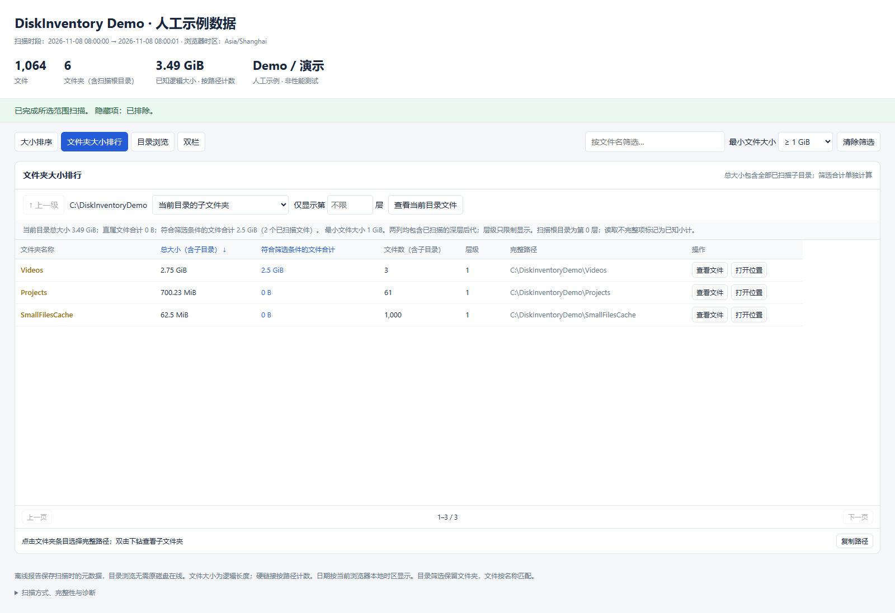
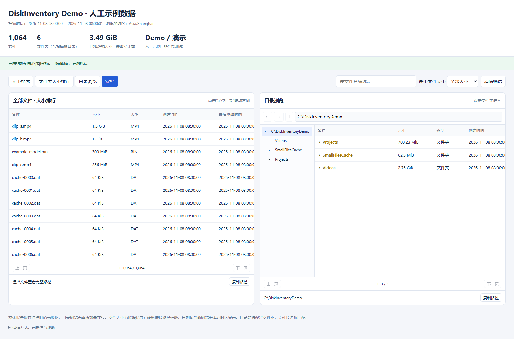

# DiskInventory

**Find large files and folders on Windows, then explore the results in a self-contained offline HTML report.**

[简体中文](README.zh-CN.md) · [Download source ZIP](https://github.com/Shizao315/disk-inventory/archive/refs/heads/main.zip) · [Download offline demo](https://raw.githubusercontent.com/Shizao315/disk-inventory/main/examples/offline-demo.html) · [Report an issue](https://github.com/Shizao315/disk-inventory/issues)

[](https://github.com/Shizao315/disk-inventory/actions/workflows/windows.yml) · [MIT license](LICENSE)

## See where the space goes



*Synthetic example: Videos contains 2.75 GiB in total, while files matching the ≥1 GiB filter account for 2.5 GiB. The folder containing 1,000 small files remains visible even when none match the filter. All screenshots and the demo use artificial data.*

- **File size ranking:** sort individual files across the selected scan scope.
- **Folder size ranking:** include all scanned descendants, including folders filled with small files.
- **Two distinct totals:** show scanned folder totals separately from the sum of files matching name and minimum-size filters.
- **Explorer-style navigation:** browse folders, go back/up, drill down by level, or show file and folder views together.
- **Offline reports:** names, paths, types, sizes and creation/modification dates stay in one HTML file; no web server or CDN is required.
- **Source desktop preview:** scan and view results in one window, copy fields, open a containing folder, verify missing paths, or optionally monitor the current directory.



The current UI is in Simplified Chinese. File names and paths retain their original text.

## Try it

| Option | Requirements | Start here |
| --- | --- | --- |
| Offline interactive demo | A modern browser | [Download the sample HTML](https://raw.githubusercontent.com/Shizao315/disk-inventory/main/examples/offline-demo.html), then open it locally. No scan or installation needed. |
| Source desktop preview | Windows, Python 3.12+, PySide6 6.9.2 | Download the source ZIP and follow the commands below. |
| Source command-line scanner | Windows, Python 3.12+ | Uses the Python standard library; see the CLI example below. |
| Native C++ scanner | Windows x64 | Build from source or use the unsigned executable in the [latest verified CI run](https://github.com/Shizao315/disk-inventory/actions/runs/42484730511). |

**Development preview.** The native executable is unsigned and may be blocked by Windows Smart App Control. Trusted signing is pending. The native Win32 window and the optional Python/Qt desktop preview are separate implementations; the Qt runtime is not bundled into the small native EXE. The original [prebuilt test archive](downloads/README.md) is retained as a historical build and does not contain every newer interface feature. See [signing status](SIGNING.md) and [validation scope](VALIDATION.md).

### Desktop preview

After downloading and extracting the source ZIP, open a terminal in the project folder:

```powershell
python -m pip install -r requirements-desktop.txt
python -B tools/desktop_viewer.py
```

Or double-click `RUN_DESKTOP.cmd` after installing the requirements. Select a folder, optionally include hidden items, and start a fresh scan. Results open in the same window. **Open historical report** reopens a snapshot; it does not rescan the disk.

### Scan from the command line

```powershell
python -B tools/dev_scan.py --root 'D:\Data' --output 'D:\inventory.html'
python -B tools/dev_scan.py --root 'D:\Data' --output 'D:\inventory-hidden.html' --include-hidden
```

This source scanner uses ordinary directory enumeration. The native C++ scanner additionally implements an NTFS MFT indexing path with directory metadata supplementation and fallback; full-volume performance has not yet been formally benchmarked. [Engine and build details](README.zh-CN.md#扫描方式与权限).

## Understand the results

- Folder totals include all scanned descendant files. Filters change the matching-file total, not the full folder total.
- A folder and its child overlap: do not add their recursive sizes together as independent disk usage.
- Sizes are logical file lengths, counted per path. They are not allocated disk space or guaranteed reclaimable space; hard links count per path.
- Hidden directories and their descendants can be excluded. Directory junctions and symbolic links are not followed automatically.
- Permission errors and incomplete directories remain visible as partial known subtotals.
- An offline report is a snapshot. In the desktop preview, current-directory updates are optional and nonrecursive; current-page existence checks cover at most 5,000 paths. They do not make the entire report a live disk index.
- Large reports are currently loaded in full. Virtual rows reduce DOM size, but do not make million-record reports low-memory. Database-backed paging is planned.

## Build and verify

The native scanner uses C++/Win32 and the SHA-256-verified official Zig 0.13.0 toolchain:

```powershell
powershell -NoProfile -ExecutionPolicy Bypass -File ./setup-toolchain.ps1
powershell -NoProfile -ExecutionPolicy Bypass -File ./build.ps1
```

GitHub Actions checks native scanning, the generated HTML in Edge, and the optional Qt desktop preview. [Current successful run](https://github.com/Shizao315/disk-inventory/actions/runs/42484730511) · [Detailed verification records](VALIDATION.md) · [Desktop behavior and limits](DESKTOP_PREVIEW.md)

## Roadmap and contributions

- Trusted signed Windows builds.
- Database-backed paging for large inventories.
- Directory exclusion rules, richer search and scan-to-scan comparisons.
- Full-volume NTFS performance measurements.

Bug reports and feature suggestions are welcome in [Issues](https://github.com/Shizao315/disk-inventory/issues). A small synthetic reproduction is especially useful. If DiskInventory helps you, a star makes it easier to find again and helps others discover the project.

## License

[MIT](LICENSE). Optional desktop dependencies keep their own licenses; see [third-party notices](THIRD_PARTY_NOTICES.txt) and the [code signing/privacy policy](CODE_SIGNING_POLICY.md).
