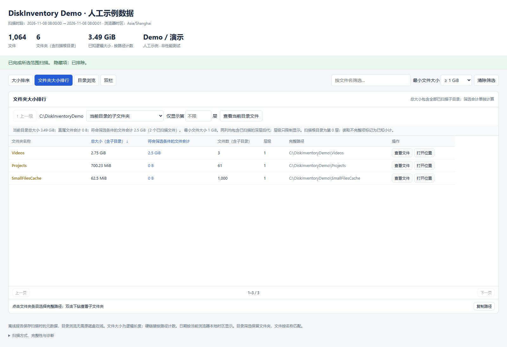
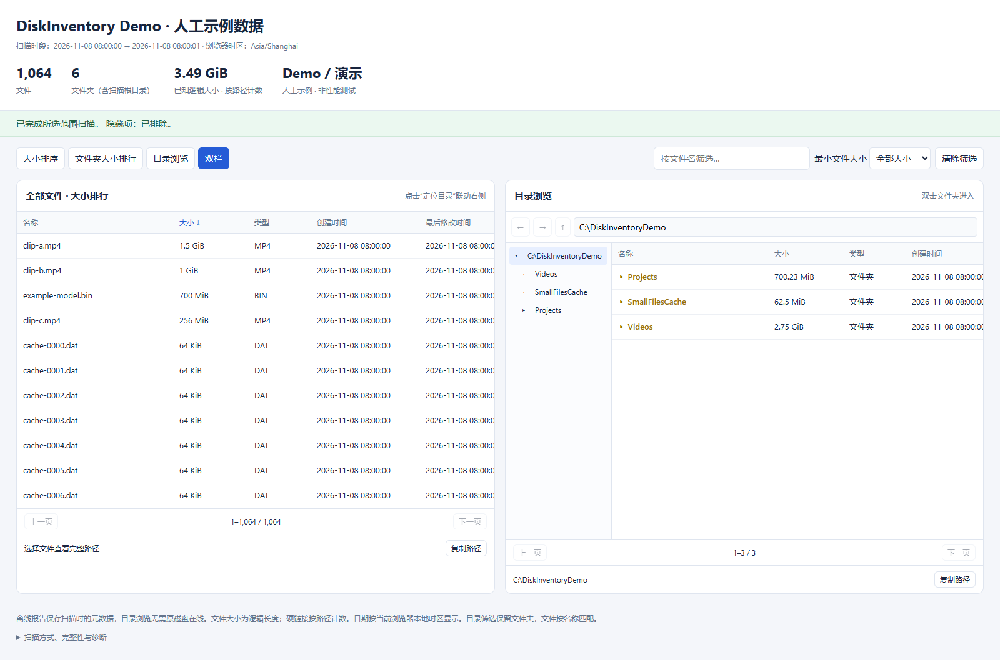

# DiskInventory

**找出 Windows 磁盘中的大文件、大文件夹，并把结果保存为可交互的离线 HTML。**

[English](README.md) · [下载最新源码 ZIP](https://github.com/Shizao315/disk-inventory/archive/refs/heads/main.zip) · [下载离线演示](https://raw.githubusercontent.com/Shizao315/disk-inventory/main/examples/offline-demo.html) · [反馈问题](https://github.com/Shizao315/disk-inventory/issues)

[](https://github.com/Shizao315/disk-inventory/actions/workflows/windows.yml) · [MIT 许可证](LICENSE)

## 看清空间用在哪里



*人工示例：Videos 总大小 2.75 GiB，满足 ≥1 GiB 条件的文件合计 2.5 GiB；包含 1,000 个小文件的目录即使没有命中大文件筛选，也仍会保留。截图和演示均使用人工数据。*

- **单文件排行**：跨目录按原始字节数排序。
- **文件夹排行**：包含全部已扫描子目录，找出由大量小文件组成的大目录。
- **两种大小分开显示**：文件夹总大小不随筛选变化，符合名称/最小大小条件的文件另行汇总。
- **资源管理器式浏览**：逐层进入、后退/前进、上一级、层级筛选和双栏联动。
- **自包含离线报告**：名称、完整路径、类型、大小、创建/修改时间均保存在 HTML 内，不需要本地服务器或 CDN。
- **内嵌界面源码试用版**：扫描和查看结果在同一窗口；支持点击复制、打开所在位置、本页存在性校验和可选的当前目录更新。



## 选择试用方式

| 方式 | 需要什么 | 入口 |
| --- | --- | --- |
| 离线交互演示 | 较新的浏览器 | [下载人工示例 HTML](https://raw.githubusercontent.com/Shizao315/disk-inventory/main/examples/offline-demo.html)，保存后打开，无需扫描 |
| 内嵌界面源码版 | Windows、Python 3.12+、PySide6 6.9.2 | 下载源码后按下方步骤启动 |
| 普通命令行源码版 | Windows、Python 3.12+ | 只需标准库，见下方命令 |
| 原生 C++ 扫描器 | Windows x64 | 本地构建，或下载[最近通过检查的 CI 构建](https://github.com/Shizao315/disk-inventory/actions/runs/42484730511) |

**当前为开发测试版。** 原生 EXE 尚未签名，可能被 Windows Smart App Control 阻止；签名申请待审核。原生 Win32 窗口与可选 Python/Qt 内嵌原型是两套实现，Qt 没有打包进小型 EXE。[原始预打包测试包](downloads/README.md)保留为历史构建，不包含后续全部界面功能。[签名说明](SIGNING.md)与[验证范围](VALIDATION.md)。

### 内嵌界面源码版

下载并解压源码 ZIP，在项目目录运行：

```powershell
python -m pip install -r requirements-desktop.txt
python -B tools/desktop_viewer.py
```

安装依赖后也可双击 `RUN_DESKTOP.cmd`。选择路径、按需包含隐藏项，点击“开始重新扫描并显示新报告”，完成后在同一窗口查看结果。“打开历史报告”只打开扫描快照，不会重新扫描磁盘。

[内嵌界面说明](DESKTOP_PREVIEW.md) · [仅标准库的源码调试版](DEV_QUICKSTART.md)

### 命令行源码扫描

```powershell
python -B tools/dev_scan.py --root 'D:\资料' --output 'D:\文件清单.html'
python -B tools/dev_scan.py --root 'D:\资料' --output 'D:\含隐藏项清单.html' --include-hidden
```

### 原生 EXE

在允许该未签名构建的环境中运行原生扫描器，选择目录、隐藏项和输出位置，再开始扫描。最新原生构建可从上述 CI 运行的 Artifacts 中取得；是否能够在你的电脑启动仍取决于系统策略。它不依赖 Python、Qt 或 Everything。

## 扫描方式与权限

- 指定文件夹：使用 `FindFirstFileExW`、`FindExInfoBasic` 和 `FIND_FIRST_EX_LARGE_FETCH` 批量枚举，直接获取长度与创建/修改时间。
- 完整 NTFS 磁盘 + 管理员：使用 `FSCTL_ENUM_USN_DATA` 建立 MFT 名称与父子关系索引，再通过目录元数据补齐大小、日期及额外硬链接名称。
- 无法使用 MFT、非 NTFS，或未提权：回退到原生目录扫描；实际方式与原因写进报告诊断。
- 默认按普通用户启动。需要时点击“以管理员重启”；若取消 UAC，原窗口保留，可继续普通扫描。此测试版不安装服务、不创建或修改 USN 日志。

MFT 枚举和补齐元数据是两个步骤，此测试版不宣称达到 Everything 的性能。快速路径在读取大小与日期时仍受目录权限限制；未知项明确保留，不伪装成零字节。

## 数据口径

- 字段包含名称、类型/扩展名、完整路径、逻辑大小、创建时间和最后修改时间。
- 文件夹大小为纳入结果的后代文件逻辑长度之和。硬链接按每个路径计数；这不等同于实际占用磁盘空间。
- 隐藏项关闭时，隐藏目录及全部后代均排除；System 属性不等同于 Hidden。
- 目录 junction、符号链接等名称替身不跟随，避免循环；保留条目并标注。云占位目录按实际重解析标签处理，不一概丢弃；不打开文件正文。
- 空目录保留。无权限、元数据未知、未跟随链接与取消状态均写入报告。目录有缺失时只展示已知大小小计。
- 报告记录扫描时段，不是原子快照；扫描过程中变化可能导致部分条目未知。
- 日期原值保存为 UTC，界面按浏览器时区显示；创建日期不等同于内容原始创作日期。
- 报告及其 `.tmp` 文件从本次清单中排除。导出先写同目录 `.tmp`，成功后再替换目标报告；失败的临时文件保留供诊断，下次请换输出名或在核实后手动处理旧 `.tmp`。

## 命令行

```powershell
.\DiskInventory.exe --root 'D:\资料' --output 'D:\扫描报告.html'
.\DiskInventory.exe --root 'C:\' --root 'D:\' --output 'D:\全盘报告.html' --include-hidden
.\DiskInventory.exe --root 'D:\资料' --output 'D:\报告.html' --engine directory
```

`--engine auto|directory|mft`：默认 `auto`；`mft` 不适用时仍回退并记录原因。`--gui` 显示窗口并将其他参数填入界面，不会自动开始。重复及重叠根目录会合并。

退出码：`0` 已导出；`1` 参数、扫描异常或导出失败；`2` 已导出但存在读取错误/未知元数据；`3` 已取消并导出部分结果。未跟随目录链接单独记录，不单独使退出码变为错误。

## 构建

使用 Zig 0.13.0 附带的 Clang/MinGW 编译 C++：

```powershell
powershell -NoProfile -ExecutionPolicy Bypass -File .\setup-toolchain.ps1
powershell -NoProfile -ExecutionPolicy Bypass -File .\build.ps1
```

准备脚本仅从 Zig 官方站点取得版本元数据和编译器，并核对官方 SHA-256；不会安装系统级软件。也可向 `build.ps1` 传入 `-ZigPath`。编译器与构建缓存放在 `.tools`、`.build`，不会打包进 EXE。

`src/report-template.html` 编译时嵌入 EXE；运行时不需要旁置模板。程序不依赖 CDN、联网请求或本地 Web 服务器。

## 验证

`tests/integration.py` 针对真实 EXE 建立有边界的人工目录并核对记录、隐藏项、日期、Unicode、长路径、硬链接、稀疏大文件和循环链接。测试结果放在 `test-output`，不进入开源样例。

`tests/report-browser.cjs` 使用 Playwright 与已安装的 Edge 验证离线报告交互，另用 12,001 条人工记录验证分页与可见行绘制。Node/Playwright 仅用于开发验证，不是最终程序依赖。

开发者可在项目目录运行：

```powershell
python -B tests/integration.py
npm install --no-save --ignore-scripts playwright@1.62.1 --registry=https://registry.npmjs.org
powershell -NoProfile -ExecutionPolicy Bypass -File tests/run-browser.ps1
```

GitHub Actions 的 Windows 工作流会从源码构建并执行这些检查。CI 构建仍然未签名；CI 通过不等于其他机器的 Smart App Control 会允许启动，也不等于全盘 MFT 性能已验证。

尚需分别验证真实大盘的 MFT 路径、百万级报告、其他 Windows 配置和各种云占位目录。具体已执行的测试与限制见交付验证记录。

许可证：MIT。实际磁盘报告可能包含私人文件名与路径，请自行决定分享范围；仓库示例使用人工数据。

## 隐私与代码签名

程序不主动向网络服务发送扫描数据；HTML 报告内嵌脚本、样式和记录，无外部请求。用户点击本地文件链接时，由浏览器和操作系统处理该路径；如扫描或打开网络共享路径，访问相应共享是该操作的一部分。

当前项目没有受信任代码签名资格，也未获准使用 SignPath Foundation。维护者已于 2026-11-08 提交免费签名申请并收到收件确认，等待审核；申请与配置说明见 [SIGNING.md](SIGNING.md)。将源码发布到 GitHub 本身不会给 EXE 添加 Windows 可信签名。

[Code signing policy](CODE_SIGNING_POLICY.md) 记录签名职责与隐私政策。[签名申请材料](signing/APPLICATION.md) 和手动工作流已准备；工作流在服务审批、参数和凭据尚未配置时会拒绝提交，当前未发送二进制签名请求。
